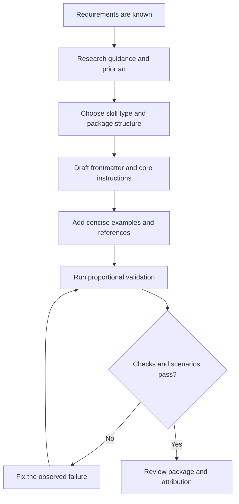

# Create Skill

## Overview

A skill is a reference guide for proven techniques, patterns, processes, or
tools. It helps future agents find and apply an effective approach.

Create or edit a skill after its purpose, trigger conditions, outputs, and
constraints are known. This skill covers research, authoring, and validation.
It does not duplicate the design interview owned by `/skill-grill`.

If the purpose, triggers, outputs, constraints, or success criteria are not
settled, stop this workflow and use `/skill-grill`. Resume `/create-skill` only
after those requirements are known.

## What Is a Skill?

**Skills are:** reusable techniques, patterns, processes, tools, and reference
guides.

**Skills are not:** narratives about how one problem was solved once.

## When to Create a Skill

**Create when:**

- a technique is not obvious;
- you would use the guidance again across projects;
- a pattern applies broadly;
- agents repeat the same mistake without focused guidance; or
- others would benefit.

**Do not create for:**

- one-time solutions;
- standard practices that authoritative sources already explain well;
- project-specific conventions that belong in repository instructions; or
- mechanical constraints that a validator can enforce.

## Skill Types

### Technique

A concrete method with steps to follow.

### Pattern

A way to recognize and reason about a class of problems.

### Reference

Facts, syntax, API details, or tool documentation.

### Process

An ordered workflow with decisions, loops, or verification gates.

A skill can combine types. Keep one clear primary purpose.

## Package Structure

```text
skill-name/
├── SKILL.md        # Required metadata and main instructions
├── references/     # Detailed material loaded only when needed
├── scripts/        # Deterministic or repeated operations
└── assets/         # Templates and files used in output
```

Add only the directories the skill needs.

## Authoring Process



### 1. Research

Inspect repository instructions, related skills, package conventions, and
authoritative sources. Reuse established terms and patterns.

Record:

- exact source URLs;
- reviewed commits or versions;
- copyright notices;
- license terms; and
- what was copied versus adapted.

If the design is incomplete, stop and use `/skill-grill`. Do not invent a
missing design inside this workflow.

### 2. Define the Boundary

Write one sentence for each item:

- the task the skill enables;
- the conditions that trigger it;
- the expected result;
- the actions or topics it does not own; and
- the evidence that shows it works.

Keep adjacent workflows separate. Link to them instead of copying their full
instructions.

### 3. Write Frontmatter

Start `SKILL.md` with YAML frontmatter:

```yaml
---
name: descriptive-skill-name
description: Use when [specific conditions, symptoms, or task contexts]
---
```

Follow the host specification and repository rules. At minimum:

- match `name` to the skill directory;
- use letters, numbers, and hyphens;
- start the description with `Use when`;
- describe concrete trigger conditions;
- include terms a user is likely to write; and
- avoid a description that summarizes the internal workflow.

The description supports discovery. The body explains execution.

## Skill Discovery Optimization

Future agents must find the skill before they can use it.

### Rich Description

Make the description answer: "Should I read this skill now?"

Use concrete triggers, symptoms, and situations. Describe the problem, not a
specific implementation symptom, unless the skill is technology-specific.

```yaml
# Weak: vague and process-focused
description: Helps make skills with tests

# Useful: specific trigger conditions
description: Use when creating new skills, editing existing skills, or verifying skills work before deployment
```

### Keyword Coverage

Use words an agent would search for:

- actions such as create, edit, validate, package, or deploy;
- artifacts such as `SKILL.md`, reference file, or skill package;
- symptoms and error messages;
- common synonyms; and
- tool or format names when they define the task.

Do not repeat keywords without purpose.

### Descriptive Naming

Use active, specific names:

- `create-skill`, not `skills`;
- `diagnose-build-failure`, not `build-help`;
- `write-release-notes`, not `documentation`.

Name the capability the agent will load.

### Token Efficiency

Context is a shared resource. Every unnecessary word reduces the space
available for the task.

Targets adapted from the source guidance:

- getting-started workflows: fewer than 150 words each;
- frequently loaded skills: fewer than 200 words total;
- other skills: fewer than 500 words when practical; and
- `SKILL.md`: under 500 lines.

These are targets, not reasons to omit required guidance.

To reduce tokens:

- refer to command help instead of copying every flag;
- cross-reference related skills instead of repeating them;
- compress examples;
- remove redundant explanations; and
- move heavy detail to references.

Check word count with an available equivalent of:

```text
wc -w path/to/SKILL.md
```

## Progressive Disclosure

Use three levels:

1. **Metadata:** name and description. The host can keep this available.
2. **Main instructions:** `SKILL.md`. Load it when the skill triggers.
3. **Bundled resources:** references, scripts, and assets. Load or run them only
   when needed.

Keep principles, concepts, and short patterns in `SKILL.md`. Use separate files
for:

- heavy reference material;
- reusable scripts or utilities;
- templates and assets; or
- content needed by only one branch of the workflow.

Point to each reference from `SKILL.md` and say when to read it. Avoid chains of
nested references.

Optional references in this package:

- Read [tdd.md](references/tdd.md) only for software test-driven development.
  It does not govern skill authoring or validation.
- Read
  [anthropic-best-practices.md](references/anthropic-best-practices.md) for the
  pinned, unmodified Anthropic vendor guidance. Its runtime assumptions are not
  universal requirements. Links to example files inside that source copy show
  vendor authoring patterns; those example files are not bundled here.
- Read [mermaid-conventions.md](references/mermaid-conventions.md) before adding
  a formal decision tree or process loop.
- Read [sources.md](references/sources.md) for source and license details.

## Write Instructions for Action

Use imperative sentences. Put the main workflow before background detail.
Explain why a constraint matters when the reason helps an agent choose.

Match instruction strength to risk:

- use guidance for context-dependent choices;
- use an ordered process when sequence matters;
- use a script when exact repeated behavior matters; and
- use a hard prohibition for a real safety, correctness, or scope boundary.

## Examples

One excellent example is better than many weak examples.

A good example is:

- complete enough to adapt;
- short;
- realistic;
- focused on one distinction; and
- explained only where the reason is not obvious.

Do not implement the same example in many languages. Do not add
fill-in-the-blank examples when direct guidance is clearer.

## File Organization

### Self-Contained Skill

```text
skill-name/
└── SKILL.md
```

Use this when all content fits and no heavy reference is needed.

### Skill with a Reusable Tool

```text
skill-name/
├── SKILL.md
└── scripts/
    └── check.py
```

Use this when executable logic is safer or more efficient than repeated prose.

### Skill with Heavy Reference

```text
skill-name/
├── SKILL.md
└── references/
    ├── api.md
    └── format.md
```

Use this when reference material is too large or too specialized for the main
file.

Invoke bundled scripts through their interpreter:

```text
bash scripts/check.sh
node scripts/check.mjs
python scripts/check.py
```

Do not invoke a script by bare path. Some package systems remove executable
bits, which makes a bare path fail with `Permission denied`.

## Formal Diagrams

Use Mermaid because GitHub renders it directly.

Use diagrams only for:

- non-obvious decision points;
- process loops where an agent might stop too early; or
- choices between two valid paths.

Use tables or lists for reference material. Use code blocks for code. Use a
numbered list for a linear process.

Use explicit nodes and labeled edges. Read
[mermaid-conventions.md](references/mermaid-conventions.md) for formal
conventions.

## Testing All Skill Types

Testing must be proportional to the skill type and risk. Do not require a
failing baseline before creating or editing a skill.

| Skill type | Test approach | Success criteria |
|---|---|---|
| Discipline-enforcing | Rule questions, realistic pressure, and combined constraints | Agent follows the rule under credible pressure |
| Technique | Application, variation, and missing-information scenarios | Agent applies the technique to a new case |
| Pattern | Recognition, application, and counter-examples | Agent identifies when and how the pattern applies |
| Reference | Retrieval, application, and gap checks | Agent finds and correctly applies the information |
| Process | Branch, loop, stop-condition, and failure-path walkthroughs | Agent completes the process without hidden steps |

For a mixed skill, combine the relevant rows.

Use baseline comparison only when it gives useful evidence. It can help show
that new guidance changes behavior. It is not a mandatory gate.

## Match the Form to the Failure

| Observed failure | Useful form |
|---|---|
| Agent skips a known rule | Clear constraint, reason, and realistic scenario |
| Output has the wrong shape | Positive output contract or template |
| Output omits a required item | Required field or structural slot |
| Behavior depends on a condition | Conditional keyed to an observable fact |
| Agent cannot find facts | Searchable reference with direct links |

Prefer a positive recipe for output-shape problems. A long list of
prohibitions can make the output less clear.

Fix observed failures. Do not add rules for hypothetical failures without
evidence.

## Common Mistakes

| Mistake | Better approach |
|---|---|
| Repeating the full requirements interview | Start after requirements are known; return unresolved design decisions to the owner |
| Writing a vague description | Name concrete triggers, symptoms, artifacts, and actions |
| Summarizing the workflow in the description | Put execution details in the body |
| Putting everything in `SKILL.md` | Use progressive disclosure |
| Adding runtime-specific tool names | Describe the capability unless the runtime is part of the skill |
| Writing a narrative about one task | Extract the reusable technique or pattern |
| Adding many similar examples | Keep one example that proves the distinction |
| Copying material without records | Record URL, revision, copyright, license, and copy status |
| Testing every skill with one harness | Match validation to the skill type and risk |
| Requiring a failing baseline | Use it only when it adds evidence |
| Using a diagram for linear steps | Use a numbered list |
| Hiding script assumptions | Name the interpreter and required inputs |

## Validation

### Package Checks

Verify:

- frontmatter parses;
- the name matches the directory;
- the description has the required trigger wording;
- every local link resolves;
- every referenced file exists;
- code blocks and Mermaid diagrams are readable;
- commands name their interpreter;
- copied and adapted material has correct attribution;
- the main file meets repository size targets; and
- repository validation passes.

### Scenario Review

Use a fresh agent or clean context when the skill will guide future agents.
Give it realistic prompts that cover:

- a normal creation task;
- an edit to an existing skill;
- a validation-only request;
- a close non-match that belongs to another workflow; and
- an incomplete-input case.

Expected outcomes:

- creation produces a focused package after requirements are known;
- editing preserves the existing skill's purpose unless the settled
  requirements change it;
- validation-only reports evidence and does not rewrite the skill unless a
  defect requires a fix;
- a close non-match returns to `/skill-grill`; and
- incomplete requirements stop and return to `/skill-grill`.

Inspect decisions and outputs, not only whether the skill was mentioned. Fix
the instruction that caused each observed failure.

Testing can be manual, automated, or both. Use the lightest method that gives
credible evidence.

## Success Criteria

A skill is ready when:

- its boundary and trigger conditions are clear;
- its package follows repository and host rules;
- its main workflow is concise and actionable;
- optional detail uses progressive disclosure;
- examples and diagrams clarify real decisions;
- proportional scenarios cover its primary behavior;
- links, structure, attribution, and repository checks pass; and
- a fresh agent can use it without hidden author context.

## Final Verification

Before deployment:

1. Read the skill as an agent that has no author context.
2. Remove duplicate, stale, and runtime-specific instructions.
3. Run package and repository checks.
4. Run the proportional scenario review.
5. Fix each issue introduced by the skill.
6. Review the final diff for scope, source records, and generated files.
