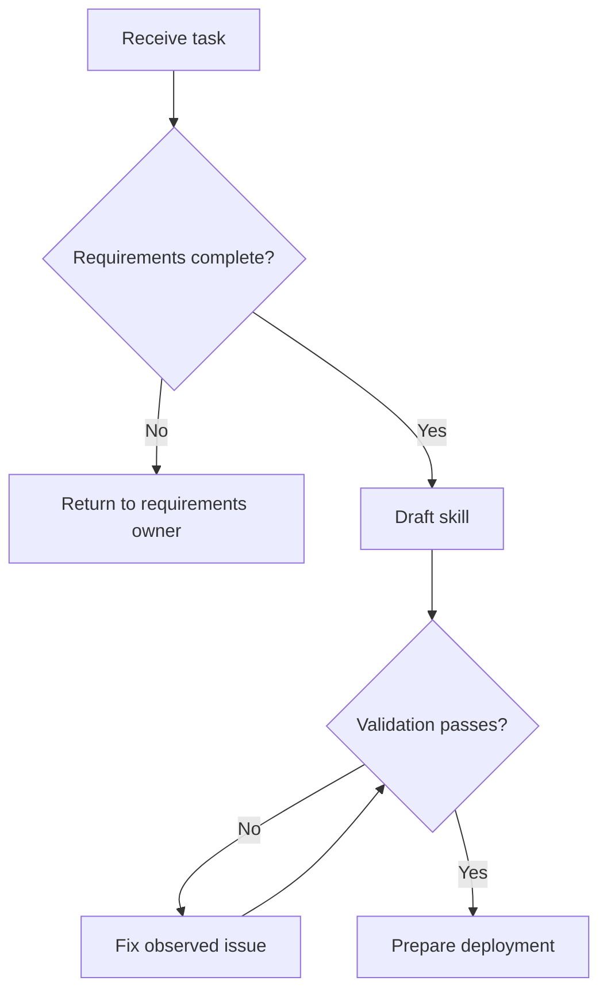
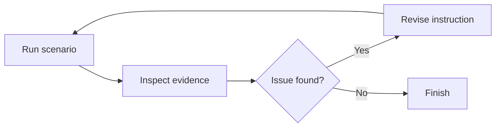
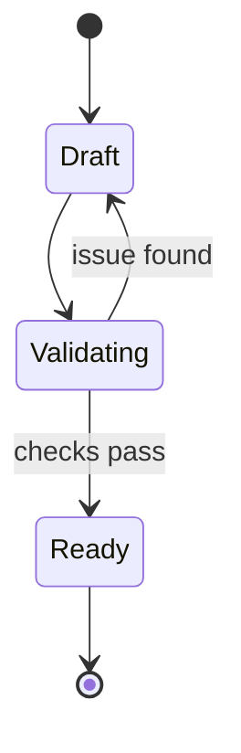

# Mermaid Conventions

Use Mermaid for formal decision trees, process loops, and state transitions.
GitHub renders Mermaid without a separate graph tool.

## Why Explicit Nodes and Edges Help

Explicit nodes make each decision or action reviewable. Explicit edges show
which result leads to which next step. This exposes hidden branches and missing
failure paths.

## Decision Trees

Use `flowchart TD` for a top-to-bottom decision tree.

Rules:

- give each node a stable short identifier;
- write actions as verbs;
- write decisions as questions;
- label each decision edge;
- show stop, error, and return paths;
- use one entry point unless the process has more than one; and
- keep line crossings low.

## Process Loops

Use `flowchart LR` for a compact repeated loop.

The return edge must show what repeats. Do not imply a loop only in prose.

## States

Use `stateDiagram-v2` when a state change is more important than an ordered
action.

## Readability

- Keep node text short.
- Put detail in nearby prose.
- Use the same terms in the diagram and instructions.
- Avoid custom colors unless meaning depends on them.
- Do not depend on a renderer-specific theme.
- Preview the Markdown in a Mermaid-capable renderer.

Use a list instead of a diagram when the process has no branch, loop, or
meaningful state transition.

