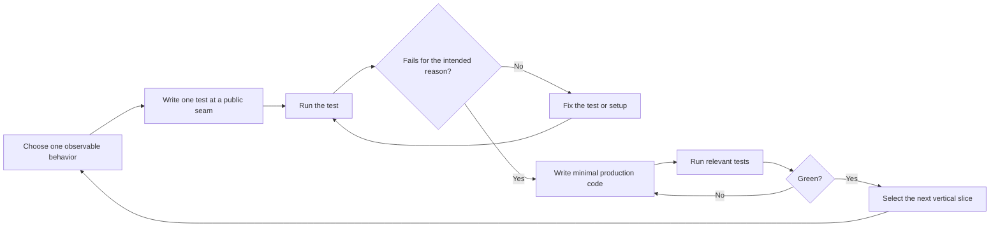

# Test-Driven Development

> This optional reference applies to software test-driven development (TDD).
> It does not govern how skills must be authored or validated.

TDD uses a red-to-green loop. First write a test that fails for the expected
reason. Then write only enough production code to make that test pass.

This reference is adapted from Matt Pocock's `tdd` skill. See
[sources.md](sources.md) for the reviewed source, copyright notice, and MIT
license terms.

## What a Good Test Is

Tests verify behavior through public interfaces, not implementation details.
Code can change completely while correct tests continue to pass.

A good test:

- reads like a behavior specification;
- uses the public interface;
- fails when that behavior breaks;
- uses an independent expected result; and
- ignores internal structure.

Avoid a **tautological test**. This is a test that calculates the expected
result in the same way as the code. It can pass by construction and fail to
detect a defect.

## Seams: Where Tests Go

A **seam** is the public boundary where a test supplies input and observes
behavior without reaching into internals.

Examples:

- an exported function;
- an HTTP endpoint;
- a command-line interface;
- a rendered user interaction;
- a message or event boundary; or
- a file operation through the application's public service.

Agree on the important seams before writing tests. For each proposed seam,
state what it detects and what it misses. Use the narrowest public seam that
proves the behavior.

## Vertical Slices

Work in vertical slices:

1. choose one behavior at one public seam;
2. write one test;
3. run it and confirm the intended failure;
4. write the smallest implementation that passes;
5. run the relevant checks; and
6. choose the next behavior from what the last cycle taught you.

The first slice is a **tracer bullet**. This is a thin end-to-end path that
proves the main parts connect.

Do not use horizontal slicing. Horizontal slicing means writing all tests first
and then all implementation. Bulk tests often verify imagined structure
instead of user-visible behavior.

## Anti-Patterns

- **Implementation-coupled:** Tests mock internal collaborators, call private
  methods, or inspect a side channel. They fail after harmless refactoring.
- **Tautological:** The assertion derives its expected result in the same way
  as the implementation.
- **Horizontal slicing:** All tests are written before any working vertical
  path.
- **Speculative implementation:** Code is added for a future test.
- **Mock-only evidence:** A test proves calls between mocks but not useful
  behavior.

Expected values must come from an independent source, such as a known literal,
a worked example, or the specification.

## Rules of the Loop

- **Red before green.** Write the failing test first. Confirm it fails for the
  intended reason.
- **One slice at a time.** Use one seam, one test, and one minimal
  implementation per cycle.
- **No speculative features.** Do not add code for a test that does not exist.
- **Review after green.** Refactor only with tests passing.

Red before green is specific to the software TDD method in this reference. It
does not require a failing baseline before a skill is created or edited.

## Verification

Confirm:

- each new behavior has a meaningful test;
- each test was observed failing for the intended reason;
- tests use stable public seams where practical;
- expected values have an independent source;
- the implementation contains no speculative features;
- relevant regression tests pass; and
- test names use the project's domain language.

