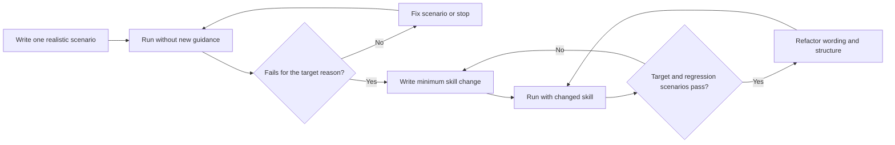

# Test-Driven Skill Authoring

This reference adapts Superpowers test-driven development (TDD) to skill
authoring. See [sources.md](sources.md) for the pinned source, copyright notice,
and MIT license terms.

## Overview

Write the scenario first. Watch the agent fail without the new guidance. Write
the minimum skill content that corrects the failure.

**Core principle:** If you did not observe the relevant failure, you do not know
whether the skill teaches the right thing.

## TDD Mapping

| Software TDD | Skill authoring |
|---|---|
| Test case | Realistic agent scenario |
| Production code | `SKILL.md` and bundled resources |
| RED | Agent fails without the new or changed guidance |
| GREEN | Agent succeeds with the guidance |
| REFACTOR | Simplify wording and close observed gaps while scenarios pass |

## When to Use

Use this method for:

- new skills;
- behavior-changing edits;
- fixes for skill behavior that failed in use; and
- refactoring after the skill is green.

A factual correction can use a focused check that proves the old fact is wrong
and the new fact is correct.

## RED: Write a Failing Scenario

Write one minimal scenario that shows the required behavior.

A good scenario:

- uses a realistic user request;
- has one main behavior;
- states objective success criteria;
- includes only the context a real agent would have; and
- can fail for the reason the skill must correct.

Run it without the new guidance:

- for a new skill, run without that skill;
- for an edit, run with the current version;
- for a factual correction, query or validate the old fact.

Confirm:

- the scenario fails;
- the failure is relevant;
- the failure is not caused by missing setup or an unclear prompt; and
- the evidence records what the agent did, not only the final answer.

Record the failure, relevant decisions, and observed output. A statement that
the scenario "did not work" is not enough evidence.

If the scenario already passes, improve the scenario or stop. Do not add
guidance for a failure you cannot reproduce.

## GREEN: Write the Minimum Skill

Change only enough guidance to make the failing scenario pass.

Prefer:

- a clear positive procedure for output-shape failures;
- a required field for omitted content;
- a condition tied to an observable fact for branching behavior;
- a direct reference for missing information; and
- a firm rule only when the agent knows the right action but skips it.

Run the same scenario with the changed skill. Confirm the target behavior now
passes and existing scenarios still pass.

Before completion, run the complete relevant scenario suite and the
repository's full validation command. A passing target scenario is not a green
suite. Report each remaining failure by name.

Do not add instructions for hypothetical future failures.

## REFACTOR: Improve Without Changing Behavior

After GREEN:

- remove duplicate wording;
- improve names and headings;
- move optional detail to references;
- shorten examples;
- replace runtime-specific terms with capabilities; and
- add a new scenario for each new gap you observed.

Run all relevant scenarios again. Keep them green.

## Scenario Types

| Skill type | Useful RED scenario |
|---|---|
| Discipline-enforcing | Agent skips a known rule under realistic constraints |
| Technique | Agent cannot apply the method to a new case |
| Pattern | Agent misses the pattern or applies it to a counter-example |
| Reference | Agent cannot find or correctly use required information |
| Process | Agent skips a branch, loop, stop condition, or failure path |

Use the scenario form that matches the expected failure.

## Good Skill Tests

| Quality | Good | Weak |
|---|---|---|
| Minimal | Tests one behavior | Mixes many unrelated requirements |
| Clear | Names the expected decision or output | Says only "works correctly" |
| Realistic | Uses normal task context | Uses artificial hints |
| Observable | Checks actions and output | Checks whether the skill was mentioned |
| Repeatable | Can run again after edits | Depends on hidden author context |

## Common Mistakes

| Mistake | Correction |
|---|---|
| Write the skill before the scenario | Save or discard the draft, then establish RED before further authoring |
| Accept any failure as RED | Confirm the failure is the behavior the skill must change |
| Change the scenario during GREEN | Keep the target stable; fix the skill |
| Add broad guidance for one narrow failure | Write the minimum general rule that explains the observed case |
| Test only the final answer | Inspect decisions, tool use, and intermediate output |
| Skip regression scenarios | Re-run existing scenarios after each change |
| Keep adding words after GREEN | Refactor for clarity and token efficiency |

## Verification Checklist

Before deployment:

- [ ] Each new behavior has a realistic scenario.
- [ ] The scenario failed before the new guidance.
- [ ] The failure was for the expected reason.
- [ ] The skill change is the minimum useful correction.
- [ ] The same scenario passes with the changed skill.
- [ ] The complete relevant scenario suite passes.
- [ ] Refactoring did not change intended behavior.
- [ ] Package, link, attribution, and full repository checks pass.

If these checks do not pass, the skill change is not verified.
